# Plant CYP450 Structural \& Docking Analysis

Computational structural and docking analysis of plant CYP450 enzymes involved in secondary
metabolite biosynthesis, extended to a pharmacogenomics classifier for human drug metabolism
prediction. Developed as a computational extension of wet-lab molecular cloning work performed
at CSIR-Central Drug Research Institute (CDRI), Lucknow, during an INSA-NASI Summer Research
Fellowship (2025) under Dr. Vineeta Tripathi, Principal Scientist.

## Working sequence: CYP76AH1 (ferruginol synthase) from *Salvia miltiorrhiza*
(UniProt S4UX02; GenBank JX422213 / protein AGN04215.1), selected as a publicly available, well-characterised plant CYP450 in terpenoid biosynthesis, as a stand-in for the *Eclipta prostrata* CYP450 characterised during the fellowship, whose sequence cannot yet be released.

## Background
During the fellowship, a CYP450 gene from *Eclipta prostrata* — involved in wedelolactone
biosynthesis — was sub-cloned into pYES2-NTB (yeast) and pCAMBIA1302 (plant/Agrobacterium)
expression vectors. The actual gene sequence belongs to an ongoing PhD project at the lab and
is not publicly available prior to publication. CYP76AH1 from *Salvia miltiorrhiza* was chosen
as a public working sequence for this computational extension because it belongs to the same
CYP76 family involved in terpenoid secondary metabolite biosynthesis, produces bioactive
compounds (tanshinones) with an analogous pharmacological profile to wedelolactone, and has
extensive published structural and docking literature available for validation.

## Phase 1 — Phylogenetics

**Sequence retrieval** The CYP76AH1 protein sequence was retrieved from NCBI Protein
(AGN04215.1), with identity cross-confirmed against UniProt (S4UX02).

**Homology search.** BLASTp was run against the full NCBI non-redundant (nr) protein database.
Eleven homologs were selected to maximise taxonomic and sequence-identity diversity (rather than
top-score alone), spanning 72–99.6% identity across the Lamiaceae family:

| Accession | Species | % Identity |
|---|---|---|
| AJD25181.1 | *S.miltiorrhiza* | 99.6% |
| KAL1532387.1 | *S. divinorum* | 85.4% |
| WEQ50542.1 | *S. officinalis* | 82.9% |
| AJQ30188.1 | *S. rosmarinus* | 81.5% |
| AMZ03392.1 | *Plectranthus barbatus* | 81.7% |
| A0A1Z3GBS4.1 | *Isodon rubescens* | 80.3% |
| BFV54790.1 | *Isodon japonicus* | 79.1% |
| CAN8716041.1 | *Dracocephalum ruyschiana* | 81.3% |
| UXG91340.1 | *Callicarpa americana* | 75.9% |
| WCR39967.1 | *Scutellaria barbata* | 72.8% |

Note: an *Artemisia annua* homolog was considered per the original project outline but excluded —
A. annua's characterised CYP450s (e.g. CYP71AV1) belong to the CYP71 family, not CYP76, and
returned no meaningful BLASTp hits against this query.

**Multiple sequence alignment.** Performed in Clustal Omega (EBI) on the query plus 11 homologs
(12 sequences total, default parameters).

**Phylogenetic tree.** A Neighbour-Joining tree was constructed in MEGA 12 (1000 bootstrap
replicates, Poisson correction, pairwise deletion), rooted at the most divergent taxon
(*Callicarpa americana*). Topology is biologically consistent: the three *S. miltiorrhiza*
sequences cluster tightly (bootstrap 86–100%), followed by a broader *Salvia* clade
(bootstrap 78–98%), with *Scutellaria* and *Callicarpa* as the most divergent outgroup pair.

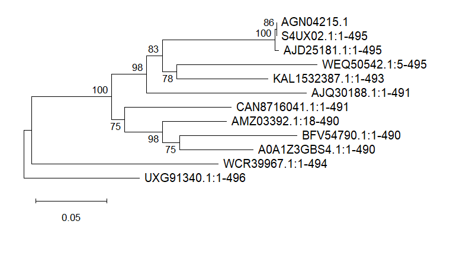

**Conserved heme-binding motif.** The canonical cytochrome P450 heme-ligand signature
(FxxGxxxCxG) was located at residues 430–439 of the query (`FGSGRRVCPG`), with the
heme-ligating cysteine at residue 437. This motif — and the cysteine in particular — is
100% conserved across all 12 sequences despite divergence of up to 27% from the query (the most distant homolog is 72.8% identical), consistent with functional constraint on this catalytically essential residue.
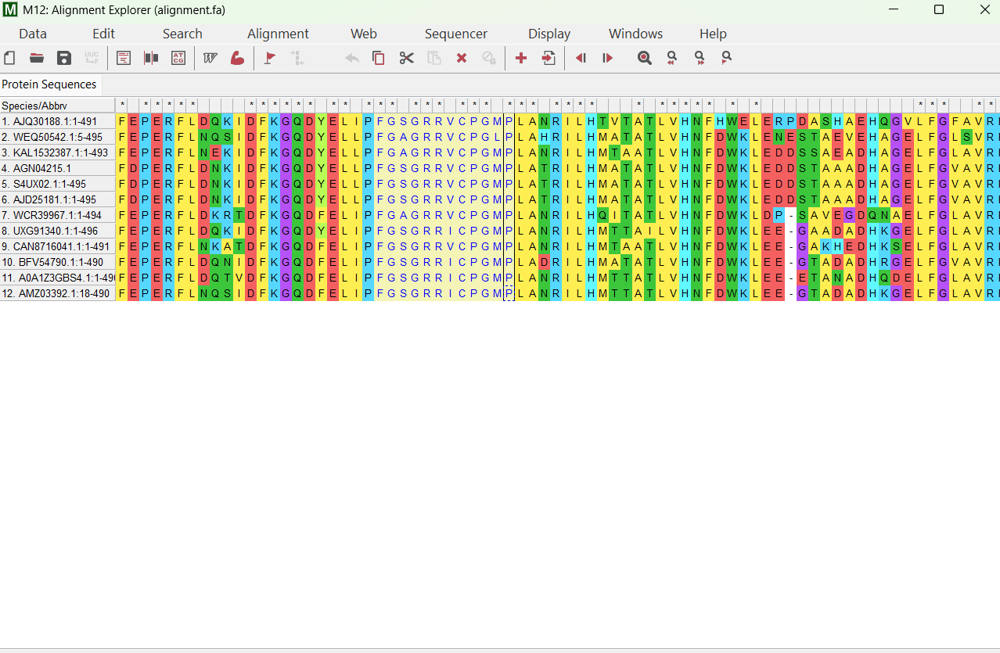

**Specificity-residue analysis (D301 / V479).** Mao et al. (2020) showed that mutating two
residues in CYP76AH1 — D301→E and V479→F — shifts product specificity from pure ferruginol
toward the broader product profile of its paralog CYP76AH3. Checking these two positions across
the alignment:

| Accession | Species | Residue 301 | Residue 479 |
|---|---|---|---|
| AGN04215.1 (query) | *S. miltiorrhiza* | D | V |
| S4UX02.1 | *S. miltiorrhiza* | D | V |
| AJD25181.1 | *S. miltiorrhiza* | D | V |
| BFV54790.1 | *Isodon japonicus* | D | V |
| AJQ30188.1 | *S. rosmarinus* | E | F |
| WEQ50542.1 | *S. officinalis* | E | L |
| KAL1532387.1 | *S. divinorum* | E | L |
| WCR39967.1 | *Scutellaria barbata* | E | L |
| UXG91340.1 | *Callicarpa americana* | E | L |
| CAN8716041.1 | *Dracocephalum ruyschiana* | E | L |
| A0A1Z3GBS4.1 | *Isodon rubescens* | E | L |
| AMZ03392.1 | *Plectranthus barbatus* | E | L |

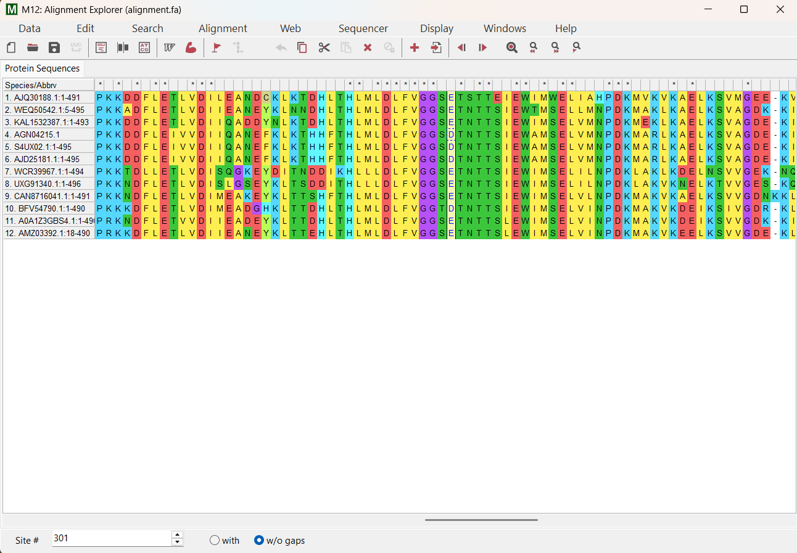
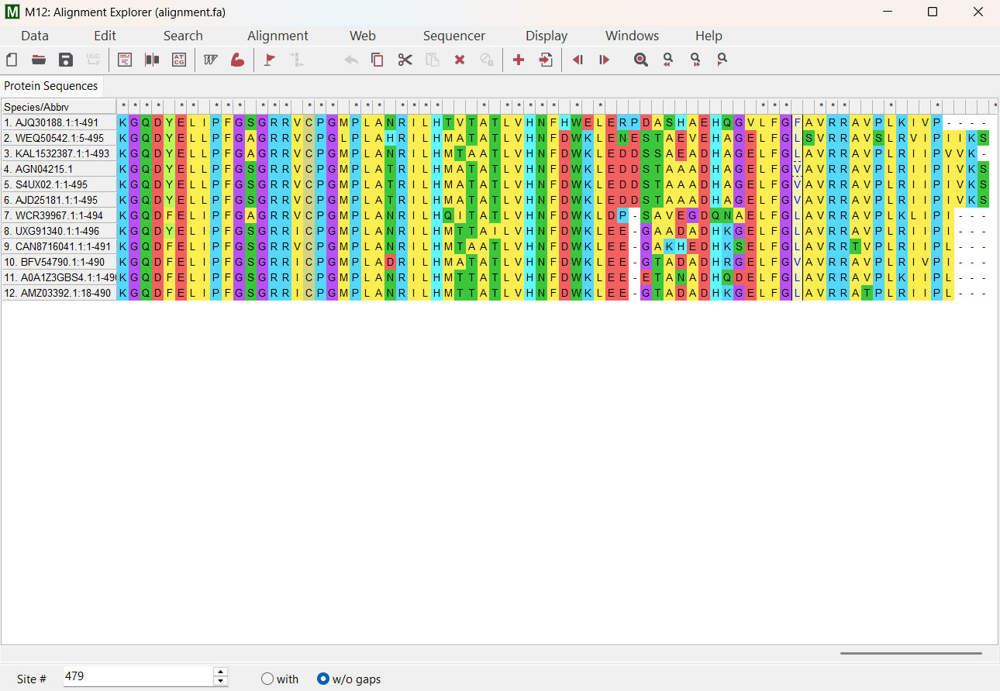

D301 and V479 co-occur perfectly across the dataset with zero exceptions: only the three
*S. miltiorrhiza* sequences and one *Isodon japonicus* homolog retain both wild-type residues,
while every other genus — including close *Salvia* relatives — has independently drifted to
the alternate pair at both positions simultaneously. This suggests the two residues co-evolve
as a functional unit, and that strict single-product (ferruginol-only) specificity may be
restricted to a narrow clade within the broader CYP76 family.

## Phase 2 — Structure Prediction & Validation (ColabFold/PyMOL)

**Structure prediction.** The CYP76AH1 sequence was submitted to ColabFold (AlphaFold2, MMseqs2
MSA mode) for 3D structure prediction. The top-ranked model achieved high confidence:
**pLDDT = 90.7, pTM = 0.89** (averaged across 3 recycles), with per-residue pLDDT mostly in the
80-95 range across all 5 generated models — indicating a reliably folded core structure, with
only isolated flexible loop regions dropping to lower confidence (50-60).

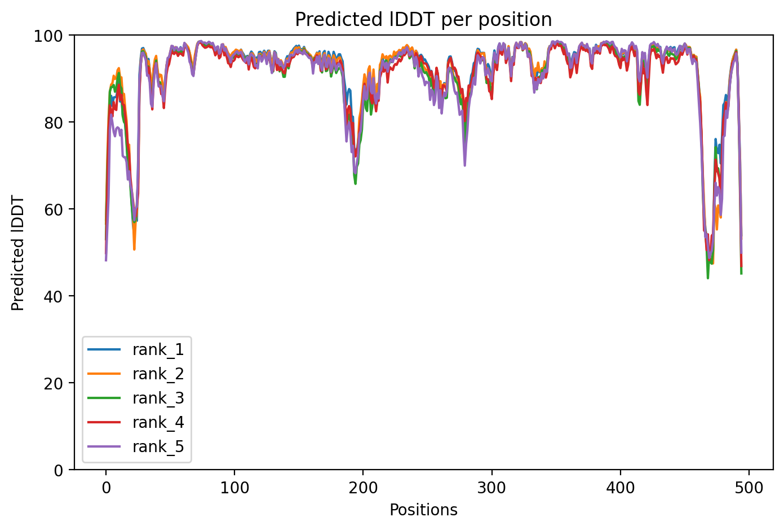
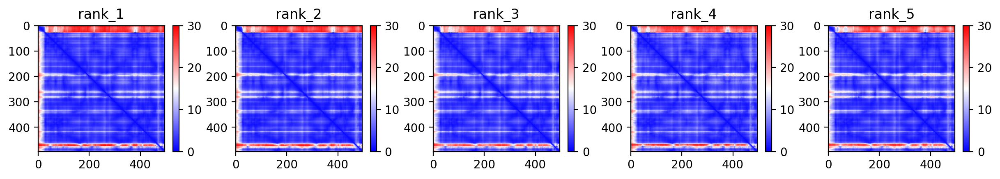
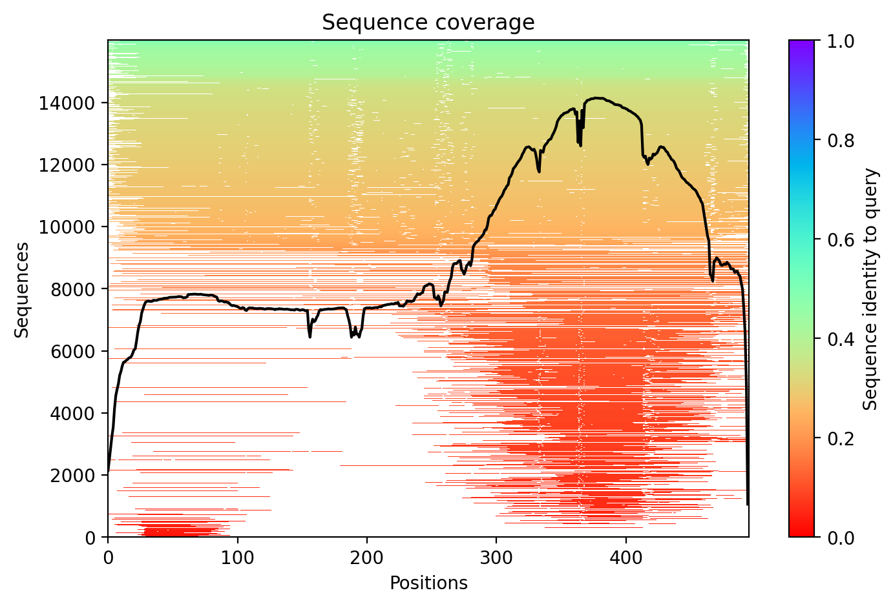

**Validation against experimental structures.** The predicted structure was aligned in PyMOL
against two published crystal structures of CYP76AH1 from *Salvia miltiorrhiza*: PDB 5YLW
(apo form) and PDB 7CB9 (in complex with heme and its natural substrate, miltiradiene). The
AlphaFold2 prediction superimposed with excellent agreement onto both:

| Reference structure | RMSD | Atoms aligned |
|---|---|---|
| 5YLW (apo) | 0.919 Å | 3015 |
| 7CB9 (substrate-bound) | 0.908 Å | 2993 |

Sub-1 Å RMSD against both experimental structures confirms the predicted model is structurally
reliable for downstream analysis.

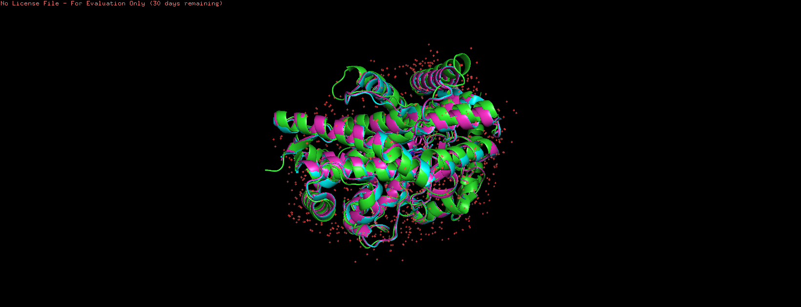

**Active site visualization.** Using the substrate-bound structure (7CB9), the heme group
(HEM) and bound miltiradiene substrate (ligand code J6C) were visualized alongside the two
specificity-determining residues identified in Phase 1 (D301, V479). Both residues were
confirmed, by direct residue identity check in PyMOL, to retain the same numbering as the
query sequence (no offset between crystal structure and UniProt/GenBank numbering). Both
residues sit at the edge of the substrate-binding pocket, immediately adjacent to the bound
miltiradiene — a direct structural explanation for why mutating either position
(D301E/V479F) alters the enzyme's product specificity (Mao et al., 2020).

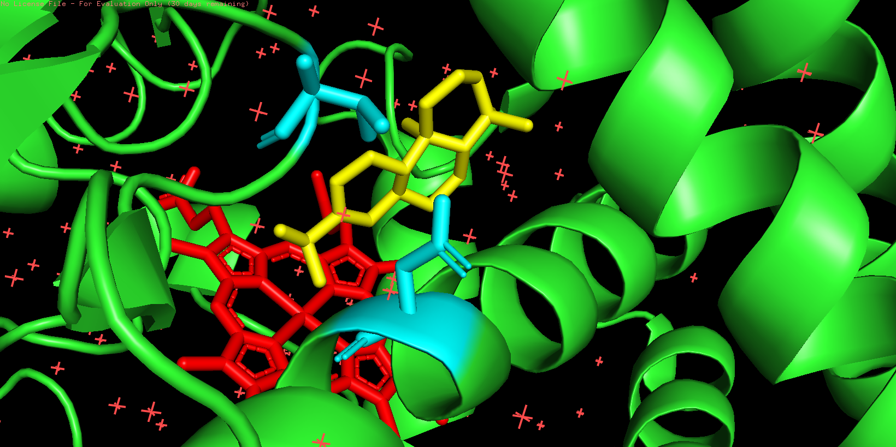

## Phase 3 — Molecular Docking (CB-Dock2)

Three ligands were docked against the AlphaFold2-predicted CYP76AH1 structure using CB-Dock2's
Structure-based Blind Docking mode (AutoDock Vina scoring, automatic cavity detection — no
pocket location specified in advance). Ligand structures were sourced from PubChem as 3D SDF
files.
- **Tanshinone IIA** (PubChem CID 164676) — a downstream pathway product of CYP76AH1
- **Cryptotanshinone** (PubChem CID 160254) — a related tanshinone pathway intermediate
- **Wedelolactone** (PubChem CID 5281813) — the bioactive compound from *Eclipta prostrata*
  linked to the original CDRI wet-lab work

**Headline finding:** all three ligands, docked independently, converged on the exact same
binding cavity (CurPocket C1, volume 6911 ų) — the same pocket already confirmed in Phase 2
to contain the heme group. This cavity's contact residues include both specificity-determining
residues from Phase 1 (**C437**, the heme-ligating cysteine, and **V479**), plus residues
immediately flanking D301 (D294, T302, N303). This is independent confirmation, via a
completely different computational method, of the active site located structurally in Phase 2.

---

### Tanshinone IIA (PubChem CID 164676)

CYP76AH1's own downstream pathway product. Docked with the **strongest affinity of the three**
ligands tested: **-10.2 kcal/mol**, into CurPocket C1 (volume 6911 ų), directly contacting
C437 and V479.

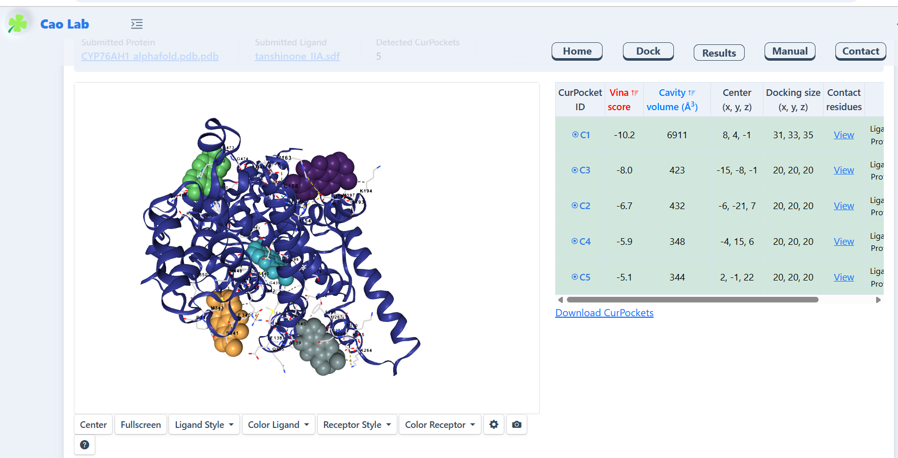

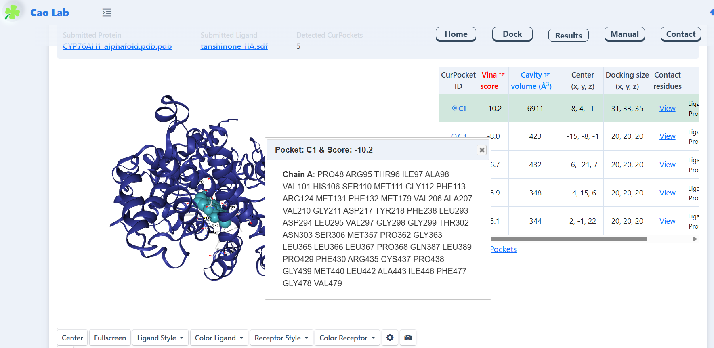

---

### Cryptotanshinone (PubChem CID 160254)

A related intermediate in the same tanshinone biosynthetic pathway. Docked into the identical
C1 pocket, with Vina score **-9.1 kcal/mol** — intermediate between tanshinone IIA and
wedelolactone, consistent with its structural similarity to tanshinone IIA.

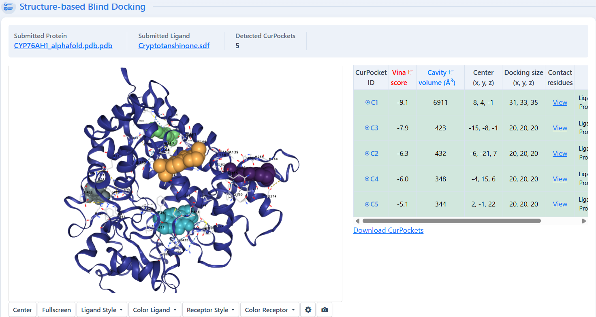

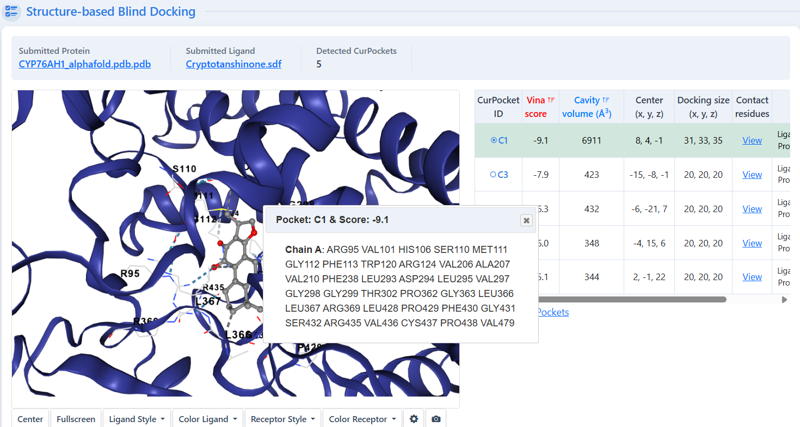

---

### Wedelolactone (PubChem CID 5281813)

The bioactive compound from *Eclipta prostrata* connected to the original CDRI wet-lab cloning
work this project extends. Despite originating from a structurally unrelated CYP450 pathway in
a different plant species, wedelolactone still docked into the same C1 pocket, contacting C437
and V479 — but with the **weakest affinity of the three**, **-8.7 kcal/mol**. This is consistent
with wedelolactone being accommodated by the pocket without being a native substrate for this
specific enzyme.

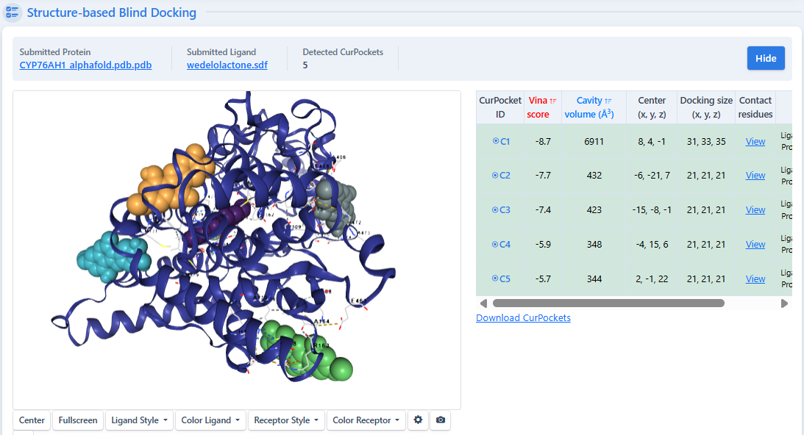

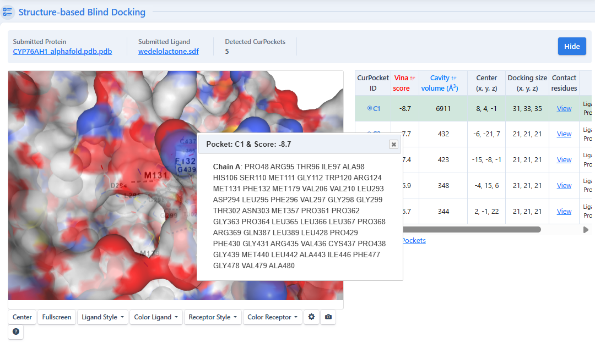

---

### Summary

| Ligand | Vina score (kcal/mol) | Cavity volume (ų) | C437 contact | V479 contact |
|---|---|---|---|---|
| Tanshinone IIA | **-10.2** | 6911 | ✓ | ✓ |
| Cryptotanshinone | **-9.1** | 6911 | ✓ | ✓ |
| Wedelolactone | **-8.7** | 6911 | ✓ | ✓ |

Binding affinity follows a biologically sensible gradient: native pathway compounds
(tanshinone IIA, cryptotanshinone) bind more tightly than a bioactive compound from an
unrelated biosynthetic pathway (wedelolactone), while all three engage the same authentic
catalytic pocket identified independently in Phase 2.

## Phase 4 — Pharmacogenomics: CYP2D6 Metaboliser-Phenotype Classifier (Python / scikit-learn)

### Why Phase 4, and why a human CYP after plant CYPs?

Phases 1 to 3 characterised a **plant** CYP450 that makes medicinal terpenoids. Phase 4 moves to a **human** CYP450, CYP2D6. The reasons, and the limits of the link:

- **Same enzyme superfamily.** The heme-binding signature found in Phase 1 is the canonical cytochrome P450 signature, so plant and human CYP450s share a catalytic design.
- **Two sides of one question.** Plant CYP450s *make* bioactive compounds such as tanshinones and wedelolactone (Phase 3). Human CYP450s *metabolise* drugs and foreign compounds. CYP2D6 is widely tested in clinical pharmacogenetics, and a person's CYP2D6 genotype affects how they handle the drugs it metabolises.
- **A verifiable task.** CPIC publishes the rule that turns a CYP2D6 genotype into a phenotype, so every step can be checked against an authoritative table.
- **The link is conceptual, not computational.** Phase 4 uses no output from Phases 1 to 3, and plant results are not used to inform the human work. It is a separate module on the same superfamily.
- **Not done here.** Docking the Phase 3 ligands into human CYP2D6 would connect the phases computationally, but it needs its own structure and validation. It is listed as future work.

### What this phase is, and is not

Each person carries two CYP2D6 alleles. CPIC gives each allele an activity value, adds the two, and applies thresholds (Caudle et al. 2020):

| Activity score | Phenotype |
| --- | --- |
| 0 | Poor metaboliser |
| above 0 and below 1.25 | Intermediate metaboliser |
| 1.25 to 2.25 | Normal metaboliser |
| above 2.25 | Ultrarapid metaboliser |

**This phase does not discover anything new.** A classifier trained on labels from a known rule can only re-learn that rule. The question is narrower: *which kind of model can recover the rule for genotypes it has never seen, using allele counts only?*

### Data

CPIC CYP2D6 tables from PharmGKB, (`pharmacogenomics/data/DOWNLOAD_NOTES.txt`). The tables are revised from time to time, so the date matters.

### Step 1 — Checking the data (`01_data_and_simulation.ipynb`)

**Why:** to confirm the CPIC rule was understood correctly before building any model.

- The functionality table lists 183 alleles. 97 have an activity value. 86 are "Uncertain" or "Unknown" function and have none.
- CPIC's diplotype table has 16,836 rows: 4,753 with a phenotype and **12,083 "Indeterminate"**. All 12,083 contain at least one allele with no activity value, so "Indeterminate" means "an allele of unknown function".
- Adding the two allele values and applying the thresholds **reproduced CPIC's score and phenotype for all 4,753 determinate diplotypes, with 0 mismatches.** Two alleles are listed as "≥3.0" copies and were read as 3.0, so for those rows the check confirms the phenotype, not an exact score.

### Step 2 — Simulated population

**Why simulate:** the project needs many people with known genotypes, and sampling from CPIC's allele frequencies gives a population that can be checked against CPIC.

- 5,000 people for each of CPIC's 9 biogeographical groups (45,000 in total, random seed 42), each with two alleles drawn independently from that group's frequencies.
- Only the 72 alleles with both an activity value and a frequency were used, rescaled to sum to 1 per group. `*38` has frequency 0 and was never drawn, so the models have **71 features**. The simulation contains **605 distinct diplotypes**.
- **Check:** simulated phenotype rates agree with CPIC's published rates (Indeterminate share removed) within **1.0 percentage point in all 36 comparisons** (9 groups x 4 phenotypes), with a mean absolute difference of about 0.3. This is only partly independent, because both come from the same allele frequencies. It shows that sampling and the rule are implemented correctly, not that the underlying biology is right. Per-group numbers: [`simulated_phenotype_percentages.csv`](pharmacogenomics/data/simulated_phenotype_percentages.csv).

### Step 3 — How the models were tested (`02_classifier.ipynb`)

- **Features:** the count (0, 1 or 2) of each of the 71 alleles. No activity score was given to the models, because the score is the label.
- **Whole diplotypes held out.** If `*1/*2` is in the test set, no `*1/*2` person is in training (0 overlap; 484 training and 121 test diplotypes on the main split). Otherwise a model could memorise diplotypes.
- **Balanced class weights**, so mistakes on the rare poor and ultrarapid classes count more.
- **Two accuracy measures.** *Person-level* accuracy is dominated by a few very common diplotypes. *Diplotype-level* accuracy counts each diplotype once and is the fairer headline.

### Results

Mean over **5 held-out-diplotype splits** (seeds 0 to 4):

| Model | Person-level accuracy | Diplotype-level accuracy |
| --- | --- | --- |
| Random Forest, baseline (300 trees) | 45.8% (std 18.7) | 61.5% (std 3.8) |
| Logistic regression (C=10) | **98.7%** (std 1.5) | **85.8%** (std 4.4) |

Logistic regression recall per class (mean of 5 splits): poor 0.97, intermediate 0.99, normal 0.99, ultrarapid 0.87. Per-split numbers: [`model_comparison_5_splits.csv`](pharmacogenomics/data/model_comparison_5_splits.csv). The five splits draw from the same 605 diplotypes and overlap, so the standard deviations are rough.

#### Baseline model: Random Forest

A Random Forest served as the baseline. On the first split it reached 51.6% accuracy.

Errors concentrated in one very common diplotype, `*10/*2`, which made up 1,209 of 4,458 test people (27%). Its score of 1.25 is the lowest value that counts as normal metaboliser, and many other errors also sat next to a threshold. Over 5 splits the baseline was unstable (normal-class recall ranged from 0.015 to 0.826), while logistic regression stayed stable. Likely explanation, **a hypothesis not tested directly**: the phenotype comes from adding allele values, tree models add up values poorly for unseen combinations, and a linear model learns one weight per allele.

#### Logistic regression

On the same split it reached 98.9% person-level and 84.3% diplotype-level accuracy. Its remaining errors concentrate in diplotypes with rare alleles (median 25 training rows for the rarest allele, against 108.5 for correct diplotypes) and in diplotypes just below a cut-off, for example `*1x2/*9` (score 2.25).

### Did the model learn the biology?

- **Signs follow CPIC activity.** `*4` and `*5` (no function) push towards Poor and away from Ultrarapid. `*1x2` (an extra working copy) pushes towards Ultrarapid. The correlation between each class's allele weights and CPIC activity values is -0.77 (poor), -0.81 (intermediate), +0.71 (normal) and +0.75 (ultrarapid).
- **Correlations are moderate, not near 1.** Likely reason, not tested: intermediate and normal are score bands, so one weight per allele cannot be a perfect line.
- **Weights are large** (up to about 20) because the classes are almost linearly separable. Read signs and ordering, not sizes.
- **SHAP** highlights common alleles (`*1`, `*2`, `*10`, `*4`, `*5`, `*41`). For a linear model SHAP largely restates the weights, so it is a consistency check, not independent evidence. Axis scales differ between panels.

### Design notes

- **Why accuracy is high.** The labels come from a sum of allele values, which a linear model can represent. Test diplotypes never appear in training, so the model cannot have memorised them. The high accuracy shows the model recovered a known rule. It is not evidence of predicting something hard.
- **Why diplotype-level accuracy is lower (85.8%).** Rare allele combinations have few training examples. Person-level accuracy is higher because most people carry common diplotypes.
- **Why simulated people.** A simulation allows every label to be checked against CPIC's table and keeps the evaluation controlled. It assumes random mating within each group and cannot show behaviour on real patient data.
- **Why Indeterminate genotypes are excluded.** CPIC gives them no phenotype, so there is no label. They are 2.5% to 10% of people depending on the group.
- **Why no activity-score feature.** The score is the label, so adding it would make the task trivial.
- **Next question.** CPIC leaves 86 alleles with uncertain or unknown function. Predicting their function from variant features, ideally with the CYP2D6 structure, would address something the rule cannot answer. That is future work.

### Scope and limitations

- Simulated population: random mating assumed, no real patient genotypes.
- Only the determinate part of CPIC's table is covered.
- One simulated population and overlapping splits, so standard deviations are rough.
- The model re-derives a published rule, so high accuracy is expected and is not a new finding.

### Files and reproduction

| File | Content |
| --- | --- |
| `pharmacogenomics/01_data_and_simulation.ipynb`, `cyp2d6_data_and_simulation.py` | Data checks, rule validation, simulation, CPIC comparison |
| `pharmacogenomics/02_classifier.ipynb`, `cyp2d6_classifier.py` | Split, models, 5-split comparison, SHAP |
| `pharmacogenomics/data/` | CPIC tables, simulated population, phenotype percentages, 5-split results |
| `pharmacogenomics/requirements.txt` | Packages (Python 3.11) |

Install `requirements.txt` and run the notebooks or scripts **from inside `pharmacogenomics/`**, because the data paths are relative. The simulation uses seed 42.

## Status
[x] Phase 1: Phylogenetics

[x] Phase 2: Structure prediction (ColabFold) and comparison to experimental structures

&#x20;     (PDB 5YLW, 7CB9)

[x] Phase 3: Molecular docking (tanshinone IIA, wedelolactone, cryptotanshinone)

[x] Phase 4: Pharmacogenomics — CYP2D6 metaboliser-phenotype classifier

## References
1.Mao, Y. et al. (2020). Functional Integration of Two CYP450 Genes Involved in
   Biosynthesis of Tanshinones for Improved Diterpenoid Production by Synthetic Biology.
   *ACS Synthetic Biology*, 9(7). https://doi.org/10.1021/acssynbio.0c00136.

2.UniProt: S4UX02 (CYPH1\_SALMI)

3. NCBI: JX422213 / AGN04215.1

4.Caudle KE et al. (2020). Standardizing CYP2D6 genotype to phenotype translation: consensus recommendations from the Clinical Pharmacogenetics Implementation Consortium and Dutch Pharmacogenetics Working Group. Clin Transl Sci 13(1):116–124. https://doi.org/10.1111/cts.12692

5.CPIC CYP2D6 allele definition, function, frequency and diplotype-phenotype tables, via PharmGKB (pharmgkb.org/page/pgxGeneRef)
